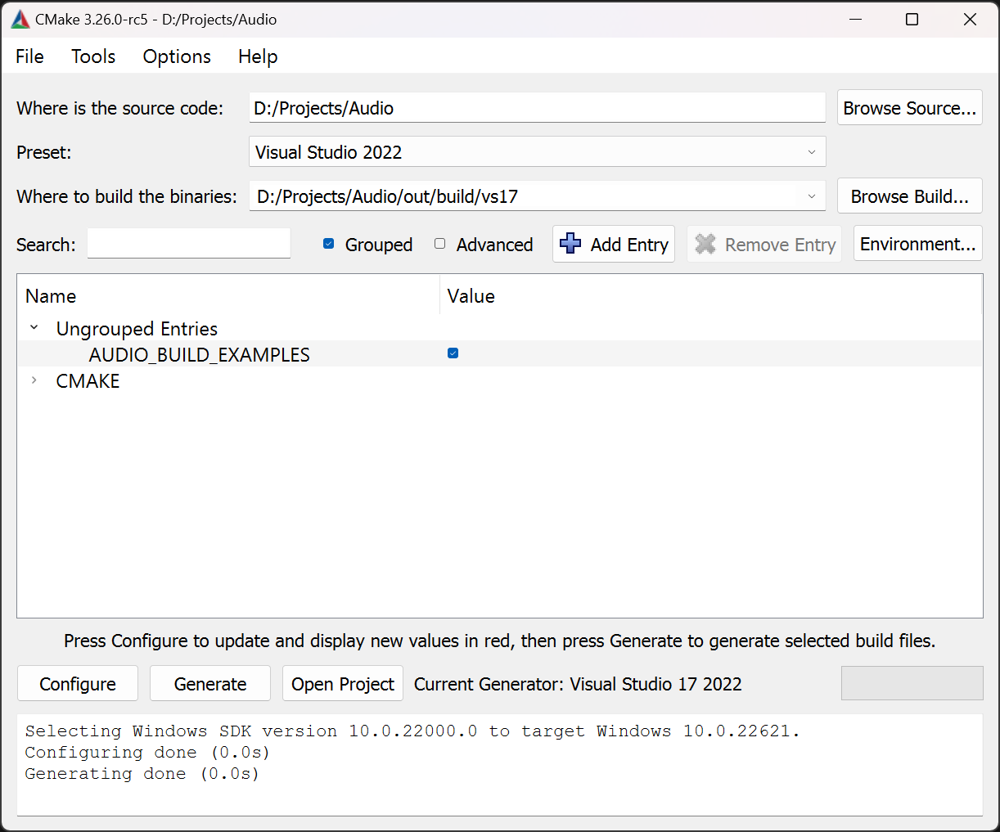

<!-- markdownlint-disable MD033 -->
# Audio Library

[](https://youtu.be/sXPN-QH1kwg)

A super minimalistic C/C++ audio library for games, built on [miniaudio](https://miniaud.io/index.html).

```cpp
#include <Audio/Audio.hpp>

int main()
{
    Audio::Sound music { "music.ogg", Audio::Sound::Type::Music };
    music.setLooping( true );
    music.play();

    Audio::playSound( "coin.wav" );  // Fire and forget.
    ...
}
```

There is no audio device to create or destroy: it is created the first time you play a sound and shut down automatically when your program exits.

## Contents

* [Features](#features)
* [Requirements](#requirements)
* [Getting the Library](#getting-the-library)
* [Building From Source](#building-from-source)
* [Integrating Into Your Own Project (Manual)](#integrating-into-your-own-project-manual)
* [Playing Sounds](#playing-sounds)
* [Playing Music](#playing-music)
* [Spatial Audio](#spatial-audio)
* [Playing Waveforms](#playing-waveforms)
* [Using a Specific Device](#using-a-specific-device)
* [Using the C API](#using-the-c-api)
* [Upgrading From v1](#upgrading-from-v1)

## Features

* Play sound effects and stream background music.
* Supported file types:
  * WAV (`.wav`): Waveform Audio File Format
  * MP3 (`.mp3`): MPEG-1/2 Audio Layer III
  * FLAC (`.flac`): Free Lossless Audio Codec
  * OGG (`.ogg`): Free, Open Container Format ([Xiph.org](https://xiph.org/))
* Volume, panning, pitch, looping, fading and scheduled start/stop.
* 3D (spatial) audio with up to 4 listeners.
* Generated waveforms (sine, square, triangle and sawtooth) for retro sound effects. See [MarioCoin.cpp](example/MarioCoin.cpp).
* A C API and a C++ API.

The library is written in C99 and exposes a C API ([audio.h](inc/Audio/audio.h)) with a thin, header-only C++ wrapper on top. Include [Audio.hpp](inc/Audio/Audio.hpp) to get the whole C++ API, or include only what you need (for example `<Audio/Sound.hpp>`).

Because only C crosses the library boundary, a compiled `Audio.lib`:

* can be linked into both **Debug** and **Release** builds of your game,
* works with both the static (`/MT`) and DLL (`/MD`) C runtime,
* does not depend on the version of the C++ standard library you use.

It should work on most platforms, but I've only tested it on Windows.

## Requirements

* A C++17 compiler for the C++ API (or a C99 compiler for the C API).
* To build from source:
  * Windows: Visual Studio 2022 or newer, with the **Game development with C++** workload (the **Desktop development with C++** workload also works, except for [GenerateProjectFiles.bat](GenerateProjectFiles.bat)).
  * CMake 3.25 or newer. CMake 4.0 or newer is needed to build the examples.

## Getting the Library

There are several ways to add the Audio library to your project. If you are not using CMake, see [Integrating Into Your Own Project (Manual)](#integrating-into-your-own-project-manual).

### Prebuilt Packages

Prebuilt packages are available on the [Releases](https://github.com/3dgep/Audio/releases) page:

* `Audio-<version>-<platform>-<compiler>-static.zip`: static library (`.lib`)
* `Audio-<version>-<platform>-<compiler>-shared.zip`: shared library (`.dll` + import `.lib`)

The `<compiler>` part of the name is the Visual Studio toolset the package was built with. Visual Studio can link libraries built with the same or an *older* toolset, but not with a newer one. For example, a package built with Visual Studio 2026 (`msvc-v145`) can't be used with Visual Studio 2022. In that case, [build the library from source](#building-from-source).

Each package contains both Debug and Release binaries:

```txt
├── include
│   └── Audio
│       ├── audio.h
│       ├── Audio.hpp
│       ├── Config.hpp
│       ├── Device.hpp
│       ├── Listener.hpp
│       ├── Sound.hpp
│       ├── Vector.hpp
│       └── Waveform.hpp
├── lib
│   ├── Debug
│   │   └── Audio.lib
│   ├── Release
│   │   └── Audio.lib
│   └── cmake
│       └── Audio
│           ├── AudioConfig.cmake
│           ├── AudioConfigVersion.cmake
│           └── AudioTargets.cmake
```

Shared packages additionally contain:

```txt
├── bin
│   ├── Debug
│   │   └── Audio.dll
│   └── Release
│       └── Audio.dll
```

> **Note**: When using the shared library, copy `Audio.dll` next to your game's executable.

### CMake: find_package

Extract a prebuilt package and use `find_package` to add it to your CMake project:

```cmake
# Point CMake to the extracted package.
list(APPEND CMAKE_PREFIX_PATH "path/to/Audio-<version>-<platform>-<compiler>-static")

find_package(Audio REQUIRED)

add_executable(MyGame main.cpp)
target_link_libraries(MyGame PRIVATE Audio::Audio)
```

CMake will automatically set up the include paths and link the correct library for your build configuration.

### CMake: FetchContent

You can also build the library as part of your project, directly from GitHub:

```cmake
include(FetchContent)

FetchContent_Declare(
    Audio
    GIT_REPOSITORY https://github.com/3dgep/Audio.git
    GIT_TAG        v2.0.0
)

FetchContent_MakeAvailable(Audio)

add_executable(MyGame main.cpp)
target_link_libraries(MyGame PRIVATE Audio::Audio)
```

### vcpkg

This repository contains a vcpkg port in the [ports](ports/) folder. Use it as an overlay port:

```sh
vcpkg install audio --overlay-ports=path/to/Audio/ports
```

Then use it in CMake:

```cmake
find_package(Audio CONFIG REQUIRED)
target_link_libraries(MyGame PRIVATE Audio::Audio)
```

## Building From Source

### Visual Studio

Open the [Audio.sln](Audio.sln) file in the root directory of this repository. You should see two projects in the solution:

1. **Audio** (static library): This project builds the `Audio.lib` file that you must link to in your own project.
2. **example** (executable): An example showing how to work with the Audio library. You can inspect the project settings of this project to see how to integrate the `Audio.lib` file into your own projects.


Select **Build > Build Solution** (<kbd>Ctrl</kbd>+<kbd>Shift</kbd>+<kbd>B</kbd>) from the main menu to build `Audio.lib` and `example.exe`.

> **Note**: The solution was made with Visual Studio 2022. If you open it with a newer version of Visual Studio, it may ask you to retarget the projects. Click **OK** to upgrade them.

### CMake on Windows

To generate a Visual Studio solution with CMake, run the [GenerateProjectFiles.bat](GenerateProjectFiles.bat) batch file. This script uses [vswhere](https://github.com/microsoft/vswhere) to detect the latest version of Visual Studio you have installed, generates the solution (including the examples) in the `out\build` folder, and opens it.

Alternatively, open the Audio folder in the CMake GUI (or run [OpenInCMake.bat](OpenInCMake.bat)):



Select a preset from the preset drop-down menu. There are presets for Visual Studio 2026 (`vs18-*`), Visual Studio 2022 (`vs17-*`), Ninja (`ninja-*`) and Clang (`clang-*`), for both the static (`*-static`) and shared (`*-shared`) library. Turn on `AUDIO_BUILD_EXAMPLES` to also build the examples. Then use the **Configure**, **Generate**, and **Open Project** buttons (in that order) to generate and open the Visual Studio solution.

You can also use the presets from the command line:

```sh
cmake --preset vs18-static -DAUDIO_BUILD_EXAMPLES=ON
cmake --build --preset vs18-static-release
```

### CMake on Linux

CMake can usually detect your build toolchain on Linux. To configure and build the Release library and the examples, run the following commands from this project's root folder:

```bash
cmake -B build -DCMAKE_BUILD_TYPE=Release -DAUDIO_BUILD_EXAMPLES=ON
cmake --build build
```

Use `-DCMAKE_BUILD_TYPE=Debug` for a Debug build, and add `-DBUILD_SHARED_LIBS=ON` to build a shared library.

No audio development packages are needed: miniaudio loads the system's audio libraries (for example PulseAudio or ALSA) at runtime.

> **Note**: Do not distribute the CMake generated project files! These files contain absolute paths and will only work for your file structure.

### Build Output

The library goes to the `lib` folder in the root of this repository, and the examples go to the `bin` folder:

* **Debug**: `lib\Debug\Audio.lib` and `bin\Debug\example.exe`
* **Release**: `lib\Release\Audio.lib` and `bin\Release\example.exe`

On Linux, the static library is `libAudio.a` (in `lib`) and the shared library is `libAudio.so` (in `bin`, next to the executables). With a single-configuration generator like Unix Makefiles, there are no `Debug` and `Release` subfolders.

The CMake build also builds `fadeExample.exe` (fading sounds in and out) and `cExample.exe` (using the C API).

### Running the Examples

The examples load audio files from the [example](example/) folder. They run directly from Visual Studio, but when running them from the command line, use the `-cwd` option to set the working directory:

```sh
.\bin\Release\example.exe -cwd ".\example"
```

If you see `[Audio] Error: Failed to load sound 'narrator.flac'` printed to the console, the wrong working directory is being used. You will still hear the waveforms (they don't load any files), but you won't hear the narrator.

## Integrating Into Your Own Project (Manual)

To use the Audio library in a Visual Studio project without CMake, copy the `lib` and `inc` folders to a folder in your own project. For example, suppose you keep your 3rd party files in a folder called `extern` or `3rdParty`.

Create a subfolder called `Audio` and copy the contents of the `lib` and `inc` folders to the `Audio` subfolder. You should have a folder structure that is similar to what is shown in the screenshot below:


Or if you prefer a textual view:

```txt
├── MyDemoGame
│   ├── extern
│   │   ├── Audio
│   │   │   ├── inc
│   │   │   │   ├── Audio
│   │   │   │   │   ├── audio.h
│   │   │   │   │   ├── Audio.hpp
│   │   │   │   │   ├── Config.hpp
│   │   │   │   │   ├── Device.hpp
│   │   │   │   │   ├── Listener.hpp
│   │   │   │   │   ├── Sound.hpp
│   │   │   │   │   ├── Vector.hpp
│   │   │   │   │   ├── Waveform.hpp
│   │   │   ├── lib
│   │   │   │   ├── Debug
│   │   │   │   │   ├── Audio.lib
│   │   │   │   │   ├── Audio.pdb
│   │   │   │   ├── Release
│   │   │   │   │   ├── Audio.lib
│   │   │   │   │   ├── Audio.pdb
```

> **Tip**: Both the Debug and the Release `Audio.lib` work in any configuration of your game. Use the Debug library if you want to step into the Audio library's code while debugging.

Alternatively, copy the contents of the [src](src/) folder to where you keep your source files and the contents of the [inc](inc/) folder to where you keep your header files, then add all of the `.c` files to your game project. In that case, you don't need `Audio.lib`, and you can skip the [Linker Settings](#linker-settings) section.

### C/C++ Settings

In order for the compiler to find the include files, you need to tell the compiler where to find the additional header files.

Open the project settings for your game project (either by right-clicking on the project in Visual Studio, or select **Project > Properties** from the main menu in Visual Studio).

Expand the **C/C++** node in the Property Pages dialog box and select the **General** subnode.


In the **Additional Include Directories**, specify the folder to the `Audio\inc` folder you copied the header files to.

> **Note**: Make sure you set the **Configuration** to **All Configurations** to apply the include directory to all build configurations!

The C++ API requires C++17 or newer. Check that the **C++ Language Standard** setting (**C/C++ > Language**) is set to **ISO C++17 Standard** or newer.

### Linker Settings

You must tell the linker where to find the `Audio.lib` file.

Open the project settings for your game project (either by right-clicking on the project in Visual Studio, or select **Project > Properties** from the main menu in Visual Studio).

Expand the **Linker** node in the Property Pages dialog box and select the **General** subnode.


In the **Additional Library Directories** setting, specify the folder to the `Audio\lib` folder you copied the `Audio.lib` files to.

> **Note**: The `$(Configuration)` macro shown in the screenshot will resolve to `Debug` when creating a debug build, and `Release` when building a release build. This way, you can specify the same path for all configurations.

Now select the **Input** subnode in the project's property pages dialog:


In the **Additional Dependencies** settings, specify `Audio.lib` for both the **Debug** and **Release** configurations.

You should be able to compile your project with the Audio library. If you have any issues, please join our Discord server: [3dgep.com Discord Server](https://discord.gg/gsxxaxc)

## Playing Sounds

The easiest way to play a sound effect is "fire and forget". The same sound can overlap itself, but you can't stop it once it has started:

```cpp
#include <Audio/Audio.hpp>
...
Audio::playSound( "explosion.wav" );
```

For more control, load a sound effect file into an `Audio::Sound` object:

```cpp
#include <Audio/Audio.hpp>
...
// Load a sound effect from a wav file:
Audio::Sound coin { "coin.wav" };
```

Later, the sound effect can be played using the `Sound::play` method:

```cpp
// Play the coin sound effect:
coin.play();
```

If the sound is already playing, `Sound::play` will not restart it. This can happen if you play many coin sounds in rapid succession. To force the sound effect to play from the beginning, use the `Sound::replay` method:

```cpp
// Force the coin sound to play from the beginning:
coin.replay();
```

Use the `Sound::stop` method to stop the sound effect:

```cpp
// Stop the sound effect:
coin.stop();
```

> **Note**: Stopping a sound effect does not rewind it to the beginning. Calling `Sound::play` again continues where it stopped. Use `Sound::seek( 0 )` to rewind the sound, or `Sound::replay` to rewind and play it.

### Volume, Pan and Pitch

```cpp
coin.setVolume( 0.5f );  // 0 is silent, 1 is 100%, above 1 amplifies.
coin.setPan( -1.0f );    // -1 is left, 0 is centered, 1 is right.
coin.setPitch( 1.5f );   // 1 is the original pitch. Higher values sound higher.

Audio::setMasterVolume( 0.8f );  // The volume of all sounds.
```

### Copying Sounds

Copying an `Audio::Sound` does not copy the sound: just like objects in C#, Java, Python or JavaScript, both copies refer to the *same* sound. This means you can pass sounds to functions and store them in other objects without worrying about it:

```cpp
void playHitSound( Audio::Sound sound )
{
    sound.play();  // Keeps playing after this function returns.
}
```

The sound is destroyed when the last copy is gone. If you need two independent sounds from the same file (for example, to set a different volume on each), load the file twice. The audio data is shared between them, so this is cheap.

### Checking for Errors

If a sound fails to load, an error is printed to the console and the sound is empty. Using an empty sound is safe (it just doesn't make any noise). You can check if a sound loaded correctly:

```cpp
Audio::Sound coin { "coin.wav" };
if ( !coin )
{
    // The sound failed to load.
}
```

Functions that can fail return an `Audio::Result`:

```cpp
Audio::Sound coin;
Audio::Result result = coin.load( "coin.wav" );
if ( result != Audio::Result::Success )
{
    std::cout << "Could not load coin.wav: " << Audio::toString( result ) << std::endl;
}
```

## Playing Music

Short sound effects are loaded into memory and decoded when they are created. For longer sounds like background music, it is better to stream the file and decode it "on the fly" while it plays. This reduces the time it takes to load the file, and the amount of memory needed to store it.

```cpp
#include <Audio/Audio.hpp>
...
// Load background music, streamed while it plays:
Audio::Sound music { "Background_Music.mp3", Audio::Sound::Type::Music };
music.setLooping( true );
music.play();
```

The only difference between loading background music and sound effects is the `Audio::Sound::Type::Music` parameter (`Type::Stream` and `Type::Background` are aliases). Playing, stopping, and restarting music works the same as for sound effects.

### Fading

Use `Sound::setFade` to fade a sound in or out:

```cpp
using namespace std::chrono_literals;

music.setFade( 0.0f, 2s );        // Fade out from the current volume over 2 seconds.
music.setFade( 0.0f, 1.0f, 2s );  // Fade in from silence over 2 seconds.
```

See [fadeExample.cpp](example/fadeExample.cpp) for more examples.

## Spatial Audio

Sound effects can be positioned in 3D space. What you hear depends on the position of the sound relative to a `Listener` (usually the player or the camera). In order to hear the correct spatial sounds, both the `Sound` and the `Listener` must be set to the correct position.

```cpp
#include <Audio/Audio.hpp>
...
// Load a sound effect from a wav file:
Audio::Sound coin { "coin.wav" };
// Set the position of the sound in the world.
coin.setPosition( { x, y, z } );
...
// Get a listener.
Audio::Listener listener = Audio::getListener();
...
// Position the listener based on the position of the player.
listener.setPosition( player.getPosition() );
// Optionally, you can also set the direction of the listener.
listener.setDirection( player.getDirection() );
```

Spatial audio allows you to specify the attenuation model for the sound effect. There are 4 attenuation models:

1. **Off**: No attenuation. This is equivalent to disabling spatialization for the sound effect.
2. **Inverse**: Default attenuation that models natural sound attenuation.
3. **Linear**: Linear attenuation falloff (less natural, but might be better for 2D sound effects).
4. **Exponential**: Exponential attenuation.

This code snippet shows how to disable attenuation for a sound effect:

```cpp
coin.setAttenuationModel( Audio::Sound::AttenuationModel::Off );
```

By default, both sounds and the listener have a position of { 0, 0, 0 }. In this case, the sounds will not exhibit any spatial attenuation.

> **Note**: Music (`Sound::Type::Music`) is not spatialized.

### Multiple Listeners

There are 4 listeners (`Audio::getListener( 0 )` to `Audio::getListener( 3 )`), for example for split-screen games. By default, a sound is heard by the closest listener. Use `Sound::setPinnedListener` to make a sound always use a specific listener:

```cpp
coin.setPinnedListener( Audio::getListener( 1 ) );
```

## Playing Waveforms

The `Audio::Waveform` class can be used to play waveform audio. Many early video games simulated sound effects using waveforms or [MIDI](https://en.wikipedia.org/wiki/MIDI) audio because it was much easier to store and synthesize the audio than use WAV files.

There are 4 types of waveforms: `Sine`, `Square`, `Triangle` and `Sawtooth`. A waveform has two properties that can be modified at runtime to achieve the desired sound effect:

* **Frequency**: The "speed" of the waveform determines the apparent pitch of the sound. This value is measured in Hz.
* **Amplitude**: The "strength" of the sound and determines how loud it sounds. This value is measured in the range from 0 (no sound) to 1 (100% volume). Amplitude is modulated by the master volume (see `Audio::setMasterVolume`).

A waveform is silent until you call `Waveform::start`:

```cpp
// A square wave with an amplitude of 0.2, at 440 Hz.
Audio::Waveform beep { Audio::Waveform::Type::Square, 0.2f, 440.0f };
beep.start();
...
beep.setFrequency( 880.0f );  // One octave higher.
...
beep.stop();
```

See [MarioCoin.cpp](example/MarioCoin.cpp) for an example of creating a more complex sound effect with a waveform.

## Using a Specific Device

Most games never need this: sounds, waveforms and listeners use the default audio device. If you need control over the device's settings, create an `Audio::Device` and pass it when creating sounds and waveforms:

```cpp
Audio::Device::Config config;
config.listenerCount = 2;
config.sampleRate    = 48000;

Audio::Device device { config };

Audio::Sound   coin { device, "coin.wav" };
Audio::Listener listener = device.getListener( 0 );
```

Sounds and waveforms keep their device alive, so the `Device` object may be destroyed before the sounds created with it.

## Using the C API

The C API in [audio.h](inc/Audio/audio.h) can be used from C, or from any language that can call C functions. Functions that take an `audio_device*` accept `NULL` to use the default device. Calling a function with a `NULL` sound or waveform is safe and does nothing. See [cExample.c](example/cExample.c) for a complete example.

```c
#include <Audio/audio.h>
...
audio_play_sound( NULL, "coin.wav" );

audio_sound* music = NULL;
if ( audio_sound_create( NULL, "music.ogg", AUDIO_SOUND_FLAGS_MUSIC, &music ) == AUDIO_SUCCESS )
{
    audio_sound_play( music );
}
...
audio_sound_destroy( music );
audio_shutdown();  // Optional when the program exits normally.
```

Errors are printed to `stderr` by default. Use `audio_set_log_callback` to send them somewhere else, or pass `NULL` to disable logging.

> **Note**: When you load the shared library at runtime (with `LoadLibrary` or `dlopen`), call `audio_shutdown` before unloading it.

## Upgrading From v1

See the [CHANGELOG](CHANGELOG.md) for all changes. The most important ones:

* The headers have the same names as in v1 (`<Audio/Sound.hpp>`, `<Audio/Device.hpp>`, ...), so existing `#include` lines keep working. You can also include `<Audio/Audio.hpp>` to get everything.
* `Audio::Device::playSound`, `setMasterVolume` and `getListener` are now free functions: `Audio::playSound`, `Audio::setMasterVolume` and `Audio::getListener`.
* `Sound::loadSound( path )` and `Sound::loadMusic( path )` are replaced by `Sound::load( path, type )`, which returns an `Audio::Result`.
* `Sound::setStartTime` and `Sound::setStopTime` now take a delay from *now* (in v1, the value was incorrectly treated as an absolute time).
* A `Waveform`'s default frequency is now 440 Hz instead of 0 Hz, and `Waveform::setSampleRate` was removed (waveforms always play at the device's sample rate).
* `Audio::Device` is now only needed if you want to create an audio device with specific settings.
